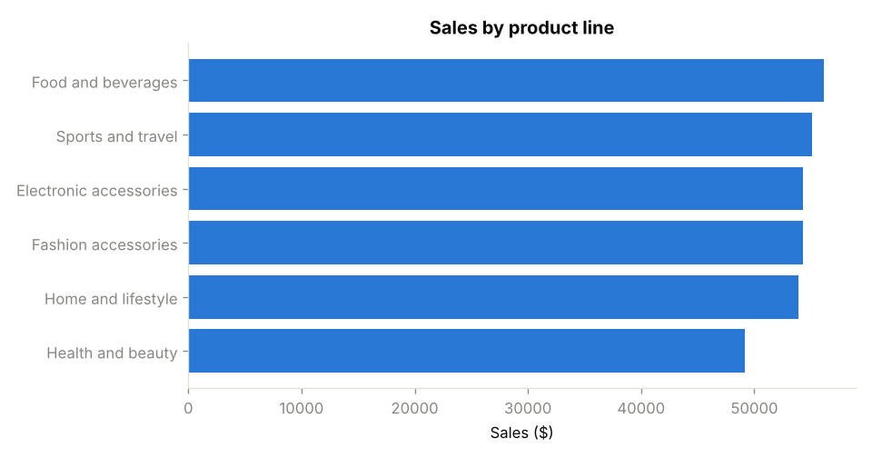

# Supermarket Sales Dashboard

An interactive sales dashboard built on a supermarket transactions dataset —
KPIs, trends and breakdowns by branch, product line, payment method and time of
day, with filters that update everything live.

> Note: this is a **Python + HTML/JavaScript dashboard**, not a Power BI `.pbix`
> file. It covers the same ground (data model, measures, interactive visuals) but
> runs in any browser with nothing to install. I built it this way so it's fully
> self-contained and viewable straight from the repo.

Data is the public "Supermarket Sales" dataset (1,000 transactions across three
branches in Myanmar, Jan–Mar 2019).



## What's in it

KPI cards: total sales, transactions, average transaction value, gross income,
average customer rating.

Charts:
- Daily sales trend
- Sales by product line
- Sales by city / branch
- Payment method split
- Sales by hour of day

Filters for **branch** and **product line** recompute every KPI and chart on the
fly.

## Headline numbers

From `outputs/kpis.json`:

| KPI | Value |
|-----|-------|
| Total sales | $322,967 |
| Transactions | 1,000 |
| Avg transaction | $323 |
| Gross income | $15,379 |
| Avg rating | 6.97 / 10 |

Sales are spread fairly evenly across the six product lines and three branches —
no single line dominates — and the day's sales pick up around the late-morning
and evening peaks (see the "by hour" chart).

## How to view it

Open **`dashboard.html`** in any browser. It reads `sales.data.js` (generated
from the raw data) and renders with Chart.js. Needs an internet connection the
first time so the charting library loads from its CDN.

To regenerate the data and the preview images from the raw CSV:

```bash
pip install -r requirements.txt
python src/prepare_data.py
```

That rewrites `sales.data.js`, the summary tables in `outputs/`, and the preview
charts the README uses.

## Layout

```
data/           supermarket_sales.csv   (raw, 1,000 rows)
src/            prepare_data.py          cleans data + builds dashboard inputs
dashboard.html  the interactive dashboard
sales.data.js   generated data the dashboard reads
outputs/        summary CSVs, kpis.json, preview figures
```

## Why not an actual Power BI file

Power BI `.pbix` files are built in Power BI Desktop (a Windows app) and are
binary, so they can't be generated from code. The data prep here (clean star-ready
tables, the KPIs, the by-dimension summaries in `outputs/`) is exactly what you'd
load into Power BI, so this doubles as a ready starting point if you want to
rebuild it there.

---

Hitesh Bharambe · [GitHub](https://github.com/HiteshBharambe99) · [LinkedIn](https://linkedin.com/in/hitesh-bharambe)
